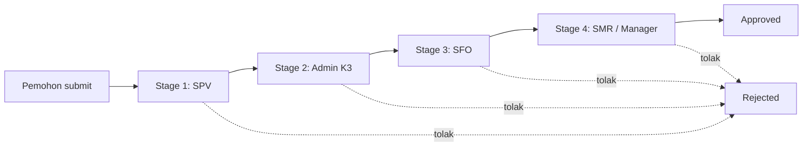

# Dokumentasi Aplikasi Form Permit (JAI Permit)

Dokumen ini menjelaskan aplikasi web **Form Permit** PT Jatim Autocomp Indonesia (JAI): tujuan, teknologi, peran pengguna, fitur, langkah pembuatan form, dan alur approval.

> Dokumen ini disusun dari struktur dan kode yang ada di project. Bagian yang bergantung pada konfigurasi (SMTP, routing, data user) bisa berbeda di tiap server.

---

## 1. Gambaran Umum

Form Permit adalah sistem **izin kerja digital (Permit to Work)** untuk menggantikan formulir kertas. Aplikasi ini mengelola pengajuan, persetujuan berjenjang, tanda tangan, dan arsip izin kerja berisiko di area pabrik, seperti kerja panas, kerja di ketinggian, dan kerja workshop.

Tujuan utama:
- Mencatat semua izin kerja dalam satu sistem, lengkap dengan nomor dokumen dan revisi.
- Memastikan setiap pekerjaan berisiko disetujui secara berjenjang oleh pihak yang berwenang (SPV, Admin K3, SFO, SMR/Manager, Security).
- Mengirim notifikasi email otomatis ke approver berikutnya.
- Menyediakan bukti persetujuan digital (QR verifikasi dan PDF).
- Mengelola dokumen pendukung seperti JSA, lisensi pekerja, inspeksi scaffolding, safety induction, dan penilaian sub kontraktor.

### Teknologi

| Komponen | Teknologi |
|---|---|
| Framework | Next.js 16 (App Router) dan React 19 |
| Bahasa | TypeScript |
| Styling | Tailwind CSS 4 dan lucide-react (ikon) |
| Database | PostgreSQL (library `pg`) |
| Autentikasi | JWT (`jsonwebtoken`), password di-hash dengan `bcryptjs`, token disimpan di cookie `jai_auth_token` (berlaku 8 jam) |
| Email | `nodemailer` (konfigurasi SMTP disimpan di database) |
| PDF/Excel | `jspdf` dan `exceljs` |
| QR Code | `qrcode` |
| Grafik | `recharts` |

Port default: `npm run dev` berjalan di **3100**.

---

## 2. Struktur Folder Utama

```
form-permit/
├── app/                      # Halaman (UI) dan API route (Next.js App Router)
│   ├── form/                 # Halaman pengisian form (hot-work, height-work, workshop, ijin-kerja-eksternal)
│   ├── my-forms/             # Riwayat dan detail form milik pemohon
│   ├── approval/             # Dashboard dan detail approval
│   ├── approval-verification/# Halaman publik verifikasi QR
│   ├── admin/ , admin-users/ # Administrasi (routing Admin K3, kelola user)
│   ├── master-lisence/       # Master lisensi sertifikasi pekerja
│   ├── purchasing/ , pengawas/ # Modul Penilaian Sub Kontraktor dan Inspeksi Scaffolding
│   ├── dashboard/            # Dashboard analitik
│   ├── login/                # Login pekerja dan login approver
│   └── api/                  # Backend: forms, approval, auth, upload, dll.
├── components/               # Komponen UI (form-selection-modal, JSA, Safety Induction, Sidebar, dll.)
├── lib/                      # Logika inti: auth, db, email, approval-email, approval-sync, routing, PDF
├── hooks/                    # Custom hook (mis. useApproverAuth)
├── migration/                # Skrip SQL migrasi database
├── uploads/                  # File upload (lisensi, tanda tangan, dll.)
└── middleware.ts             # Proteksi route berdasarkan login
```

File kunci:
- [`lib/auth.ts`](lib/auth.ts): definisi role, stage approval per jenis form, JWT.
- [`lib/approval-email.ts`](lib/approval-email.ts): notifikasi email ke approver berikutnya.
- [`lib/approval-sync.ts`](lib/approval-sync.ts): sinkronisasi approval otomatis (cascade) antara form induk eksternal dan lampirannya.
- [`lib/admin-k3-routing.ts`](lib/admin-k3-routing.ts): penentuan Admin K3 per jenis form.
- [`lib/nav-config.ts`](lib/nav-config.ts): menu sidebar dan kartu beranda per role.

---

## 3. Peran Pengguna (Role)

| Role | Fungsi |
|---|---|
| `worker` | Pemohon. Membuat form dan memantau riwayat serta status di **Riwayat Form** (`/my-forms`). |
| `firewatch` | Hanya sebagai informasi di form (nama dan NIK), **tidak punya stage approval**. |
| `kontraktor` | Menandatangani form secara bebas lewat endpoint tanda tangan, **tidak menempati stage approval**. |
| `spv` | Approver tahap 1. SPV hanya melihat form dari departemennya (atau yang ditunjuk sebagai "SPV Terkait"). |
| `admin_k3` | Approver tahap 2 (verifikasi K3). Untuk Kerja Ketinggian mengisi checklist Helm, Body Harness dan Lanyard. |
| `sfo` | Approver tahap 3. |
| `smr` | Approver tahap 4 (SMR / PGA Manager). Sebelumnya bernama `pga`. |
| `security` | Pada Ijin Kerja Eksternal: mengisi Safety Induction dan menandatangani sebagai tahap akhir. Hanya ada 1 di perusahaan. |
| `purchasing` | Menilai sub kontraktor (Penilaian Sub Kontraktor). |
| `pengawas` | Pengawas departemen: checklist pengawasan harian dan Inspeksi Scaffolding. |
| `admin` | Akses penuh: kelola user, departemen, lisensi, SMTP, routing, dan dashboard. |

Menu sidebar berbeda untuk tiap role (lihat `lib/nav-config.ts`).

---

## 4. Jenis Form

Form dipilih lewat **modal pemilihan form** (`components/form-selection-modal.tsx`). Setiap kartu menampilkan nomor dokumen dan revisi.

| Form | Untuk | No. Dokumen | Revisi |
|---|---|---|---|
| **Form Kerja Panas** (Hot Work) | Pengelasan, pemotongan, grinding, painting | JAI/F-05/P.SHE-19 | Rev. 1 |
| **Form Kerja Ketinggian** (Height Work) | Pekerjaan di ketinggian (tangga, scaffolding, AWP) | JAI/F-09/P.SHE-19 | Rev. 0 |
| **Form Kerja Workshop** | Maintenance, perbaikan, instalasi di workshop | JAI/F-12/P.SHE-19 | Rev. 1 |
| **Form Ijin Kerja Eksternal** | Pekerjaan oleh sub kontraktor / pihak luar | JAI/F-01/P.SHE-19 | Rev. 4 |
| Inspeksi & Kelayakan Scaffolding | Lampiran Kerja Ketinggian | JAI/F-14/P.SHE-19 | Rev. 0 |
| Job Safety Analysis (JSA) | Lampiran semua form | JAI/F-10/P.SHE-19 | Rev. 2 |

Tiga form pertama bisa dibuat oleh karyawan **internal** maupun terhubung ke **Ijin Kerja Eksternal**. Form Ijin Kerja Eksternal menjadi "form induk" yang dapat memiliki lampiran: Form Kerja Panas, Ketinggian, Workshop, JSA, Safety Induction, Penilaian Sub Kontraktor, dan lisensi pekerja.

---

## 5. Fitur Utama

### 5.1 Autentikasi dan Hak Akses
- Login pekerja dan login approver terpisah (`/login/approver`).
- JWT disimpan di cookie HTTP-only, kedaluwarsa 8 jam.
- `middleware.ts` melindungi halaman sesuai login; API memeriksa role di setiap endpoint.

### 5.2 Pembuatan dan Pengelolaan Form
- Formulir bertahap per bagian (identitas, lokasi, bahaya, APD, checklist, dll.).
- Form dapat berstatus `draft`, `submitted`, `approved`, atau `rejected`.
- **Edit Token** (format `XXXX-XXXX`) dibuat untuk tiap form.
- Pemohon dapat mengedit form yang sudah `submitted` selama belum diproses Admin K3 (belum `admin_k3_approved` dan stage < 2).
- Form yang ditolak dapat diperbaiki berdasarkan catatan penolakan.

### 5.3 Dokumen Pendukung
- **JSA (Job Safety Analysis)**: dua cara, *Upload JSA* atau *Buat JSA* lewat formulir. JSA punya alur persetujuan sendiri (Pengawas, SPV, SFO).
- **Lisensi / Sertifikasi pekerja**: dari **Master Lisence** (hot work, height work, workshop) atau upload berkas, lengkap dengan tanggal kedaluwarsa.
- **Inspeksi Scaffolding**: checklist 17 komponen perancah (kartu popup dengan background blur pada form Kerja Ketinggian).
- **Safety Induction** (eksternal): diisi dan ditandatangani Security.
- **Penilaian Sub Kontraktor**: dinilai Purchasing, Pengawas, lalu disetujui SFO.
- **Peminjaman APD** dan keterangan khusus (mis. penggunaan tangga listrik/AWP malam hari harus lewat Security dan memastikan intensitas cahaya cukup).

### 5.4 Approval Berjenjang
- Approver hanya melihat form yang sedang menjadi gilirannya.
- Tindakan: **Setujui** atau **Tolak** (wajib mengisi catatan penolakan).
- Persetujuan di form induk eksternal otomatis diteruskan ke lampirannya (`approval-sync`).

### 5.5 Notifikasi Email
- Email otomatis ke approver tahap berikutnya setelah tahap sebelumnya disetujui.
- Email penolakan ke pembuat form.
- Pengaturan SMTP dikelola admin di halaman **Pengaturan SMTP**.

### 5.6 Routing Approver
- **Routing Admin K3** (`/admin/admin-k3-routing`): admin menentukan Admin K3 mana yang menerima tiap jenis form (Hot Work, Kerja Ketinggian, Workshop, dan Ijin Kerja Eksternal). Jika belum diatur, email dikirim ke semua Admin K3.
- **SPV Terkait**: pemohon memilih SPV yang akan menyetujui; hanya SPV tersebut yang melihat form.
- **Pilih approver berikutnya**: setelah Admin K3 menyetujui, muncul pilihan user SFO tujuan; setelah SFO menyetujui, muncul pilihan user SMR/Manager. Pada tahap SMR dan Security tidak ada pilihan.

  > Fitur ini baru ditambahkan. Pastikan perubahannya sudah di-accept dan lolos `tsc` sebelum dipakai.

### 5.7 Pencetakan, QR, dan Ekspor
- Unduh **PDF** form (`lib/generatePermitPdf.ts`).
- **QR Code** verifikasi digital pada tiap approval; halaman publik di `/approval-verification/...` menampilkan keabsahan persetujuan.
- Ekspor data ke Excel.

### 5.8 Administrasi dan Monitoring
- **Dashboard Analitik** (`/dashboard`): statistik pengajuan.
- **Kelola Akun Users**, **Kelola Departemen**, **Master Lisence**, **Daftar File Form**, **Pengaturan SMTP**.
- SPV dapat mengelola akun departemennya sendiri.

---

## 6. Langkah Pembuatan Form (Step by Step)

### 6.1 Form Internal (Hot Work / Kerja Ketinggian / Workshop)
1. **Login** sebagai pemohon (`worker`) lalu buka **Beranda**.
2. Pilih **Buat Form**; muncul **modal pemilihan form**. Pilih jenis form dan perhatikan nomor dokumen/revisinya.
3. Isi **identitas pekerjaan**: tanggal pelaksanaan, lokasi, deskripsi pekerjaan, waktu, kontraktor/pekerja (NIK).
4. Isi **detail bahaya dan pencegahan**:
   - *Kerja Panas / Workshop*: jenis pekerjaan (cutting, grinding, welding, painting), kondisi area, APAR, Fire Watch.
   - *Kerja Ketinggian*: petugas dan kondisi kesehatan, alat bantu, harness, rambu, serta keterangan **Peminjaman APD**.
5. Pilih **SPV Terkait** (penyetuju tahap 1).
6. **Lisensi pekerja**: pilih dari Master Lisence atau upload.
7. **JSA**: pilih *Upload JSA* atau *Buat JSA* bila pekerjaan memerlukannya.
8. Khusus **Kerja Ketinggian**: pilih *Ya, Perlu Scaffolding*. Klik **Buat Inspeksi Scaffolding** untuk membuka popup checklist 17 komponen. Pengajuan baru diteruskan ke SPV setelah inspeksi scaffolding disubmit.
9. Periksa, lalu **Submit**. Sistem membuat nomor form, status menjadi `submitted`, dan mengirim email ke approver pertama (SPV).
10. Pantau status di **Riwayat Form** (`/my-forms`): lihat detail, cetak PDF, atau edit selama belum diproses Admin K3.

### 6.2 Form Ijin Kerja Eksternal (Sub Kontraktor)
1. Pemohon memilih **Form Ijin Kerja Eksternal**.
2. Isi data kontraktor dan pengawas: nama kontraktor/pekerja, PIC subkont, jumlah tenaga kerja, periode kerja.
3. Isi spesifikasi pekerjaan, alat dan mesin, lokasi, bahan berbahaya, dampak, APD, APAR, pengelolaan limbah.
4. **Bagian 11**: pilih **SPV Terkait**.
5. **Bagian 15**: Pengawas Pekerjaan / User PT. JAI terisi otomatis dengan format `Nama Pengawas/PIC Subkont - Nama Pengawas Bagian PT. JAI`.
6. Lampirkan/buat **JSA** dan **lisensi**; opsional tambahkan form kerja panas / ketinggian / workshop sebagai lampiran.
7. **Kontraktor menandatangani** form (tanda tangan digital di tablet).
8. Submit; email dikirim ke SPV terkait.

---

## 7. Alur Approval (Step by Step)

### 7.1 Form Internal (Hot Work, Kerja Ketinggian, Workshop)



| Stage | Role | Keterangan |
|---|---|---|
| 1 | SPV | Menyetujui form departemennya (atau yang menunjuknya sebagai SPV Terkait). |
| 2 | Admin K3 | Verifikasi K3. Untuk Kerja Ketinggian mengisi checklist Helm, Body Harness dan Lanyard. Hanya Admin K3 yang di-routing yang menerima (bila diatur). |
| 3 | SFO | Menyetujui; user SFO dapat dipilih oleh Admin K3. |
| 4 | SMR / Manager | Persetujuan akhir; user dapat dipilih oleh SFO. Setelah ini status menjadi `approved`. |

Detail tiap langkah:
1. Pemohon submit, sehingga `current_stage = 1`. Untuk Kerja Ketinggian yang memerlukan scaffolding, form masuk antrian SPV hanya setelah inspeksi scaffolding disubmit.
2. Email dikirim ke SPV. SPV membuka **Daftar Form** (`/approval`), meninjau detail dan lampiran, lalu **Setujui** atau **Tolak**.
3. Setelah disetujui, `current_stage` naik dan email dikirim ke Admin K3 (sesuai routing). Admin K3 menyetujui dan memilih SFO tujuan (jika fitur pilih approver aktif).
4. SFO menyetujui, lalu memilih SMR/Manager tujuan.
5. SMR menyetujui. Status menjadi `approved`, QR digital dan PDF tersedia.
6. Jika ada yang **menolak**, status menjadi `rejected` dan catatan penolakan dikirim lewat email ke pemohon. Pemohon memperbaiki dan mengajukan ulang.

### 7.2 Form Ijin Kerja Eksternal

| Stage | Role | Keterangan |
|---|---|---|
| (awal) | Kontraktor | Tanda tangan di form (tidak menggeser stage). |
| 1 | SPV | SPV Terkait yang dipilih di Bagian 11. |
| 2 | Admin K3 | Dapat di-routing khusus lewat halaman Routing Admin K3. |
| 3 | SFO | |
| 4 | SMR / PGA Manager | |
| 5 | Security | Mengisi **Safety Induction** dan menandatangani. Hanya ada 1 Security, jadi tidak ada pilihan user. Setelah ini form `approved`. |

Catatan:
- **Cascade approval**: persetujuan SPV, Admin K3, SFO, dan SMR pada form induk otomatis diterapkan ke lampiran (form kerja panas/ketinggian/workshop, JSA, penilaian subkontraktor) lewat `lib/approval-sync.ts`. Sebaliknya, persetujuan pada lampiran ikut menyinkronkan form induk.
- **JSA** punya alur sendiri: Pengawas → SPV → SFO.
- **Penilaian Sub Kontraktor**: diisi Purchasing dan Pengawas, disetujui SFO.

### 7.3 Aturan Visibilitas Antrian
- SPV: hanya form departemennya, atau form yang menunjuknya sebagai SPV Terkait.
- Admin K3: hanya form jenis yang di-routing ke dirinya (bila routing diatur).
- SFO/SMR: form pada tahapnya; bila pengirim memilih user tertentu, hanya user itu yang melihat dan boleh menyetujui.
- Security: form eksternal pada tahap akhir.

---

## 8. Database (Ringkasan)

Tabel utama (lihat `struktur-database.txt` dan folder `migration/`):

| Tabel | Isi |
|---|---|
| `users` | Akun, role, departemen, email, NIK |
| `departemen` | Daftar departemen |
| `form_kerja_panas` | Form Kerja Panas |
| `form_kerja_ketinggian` | Form Kerja Ketinggian |
| `form_kerja_workshop` | Form Kerja Workshop |
| `form_ijin_kerja` | Form Ijin Kerja Eksternal (induk) |
| `inspeksi_scaffolding` | Inspeksi dan kelayakan scaffolding |
| `master_lisence` | Master lisensi pekerja |
| `pengawas_departemen` | Data pengawas per departemen |
| `smtp_settings` | Konfigurasi email |
| `admin_k3_email_routing` | Routing Admin K3 per jenis form |
| `form_approver_assignments` | Penugasan approver SFO/SMR terpilih per form (dibuat otomatis oleh aplikasi) |

Setiap form menyimpan kolom per tahap approval: `*_approved`, `*_approved_by`, `*_approved_at`, `*_nik`, serta `current_stage`, `status`, dan `catatan_reject`. Kolom `mr_pga_*` dipertahankan untuk data lama walaupun role `pga` kini bernama `smr`.

---

## 9. Menjalankan Aplikasi

1. Pasang dependensi: `npm install`
2. Buat file `.env` berisi: `DB_HOST`, `DB_PORT`, `DB_NAME`, `DB_USER`, `DB_PASSWORD`, `JWT_SECRET`.
3. Siapkan database PostgreSQL (skema ada di `struktur-database.txt` dan `migration/`).
4. Jalankan mode pengembangan: `npm run dev` (port 3100).
5. Build produksi: `npm run build`, lalu `npm start`.
6. Atur **SMTP** di halaman admin supaya email notifikasi berfungsi.
7. Atur **Routing Email Admin K3** bila ingin form diarahkan ke Admin K3 tertentu.

---

## 10. Ringkasan Alur End-to-End

```mermaid
sequenceDiagram
    participant P as Pemohon
    participant S as Sistem
    participant A as Approver
    P->>S: Isi dan submit form (+ JSA, lisensi, scaffolding)
    S->>A: Email ke approver tahap 1 (SPV)
    A->>S: Setujui / Tolak
    S->>A: Email ke approver berikutnya (Admin K3, SFO, SMR; Security untuk eksternal)
    A->>S: Setujui di setiap tahap
    S->>P: Status Approved, QR dan PDF tersedia
```

